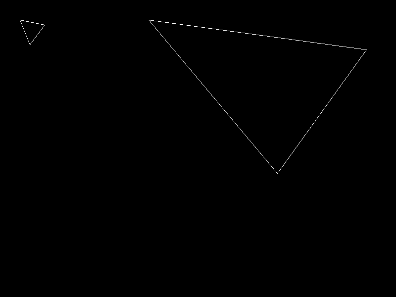
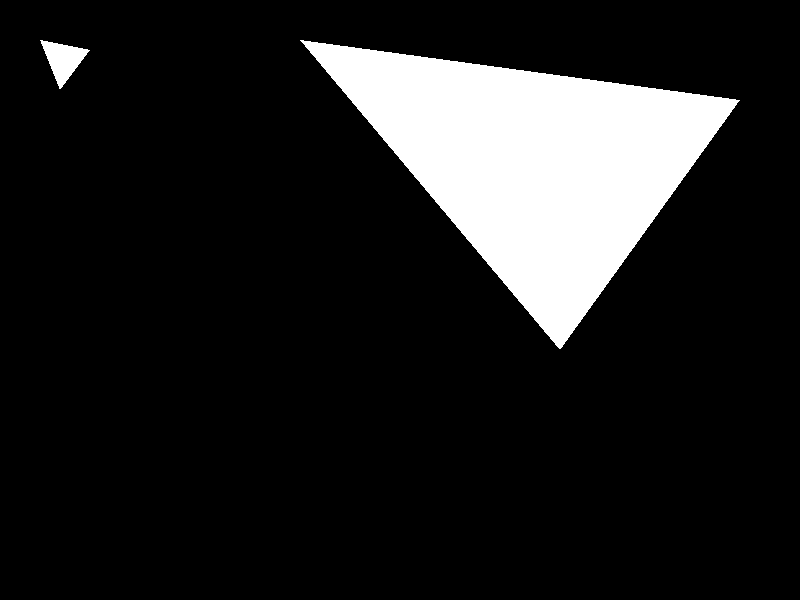
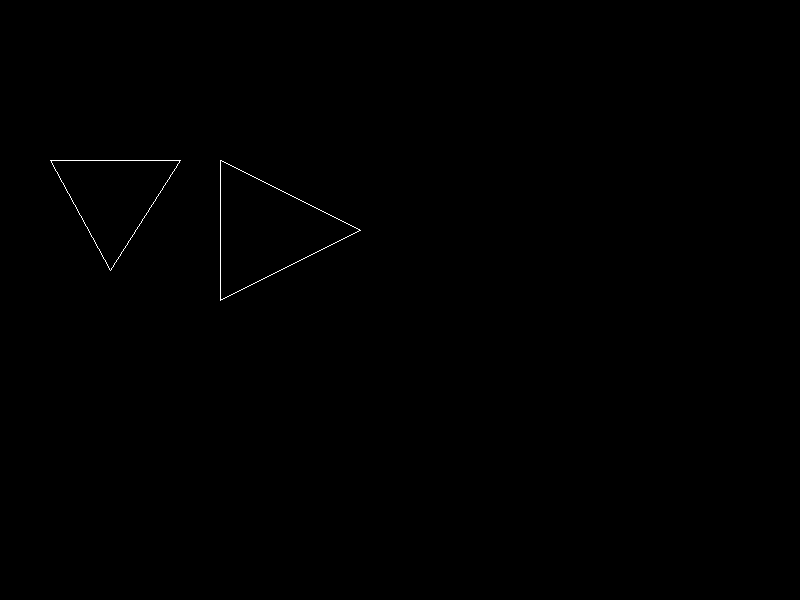
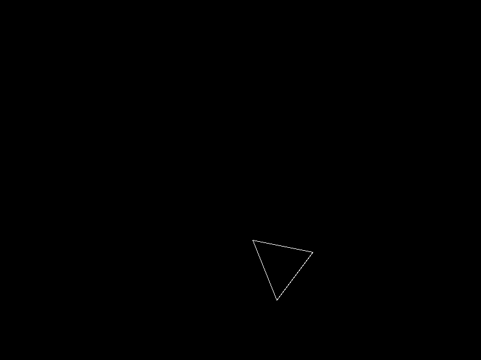
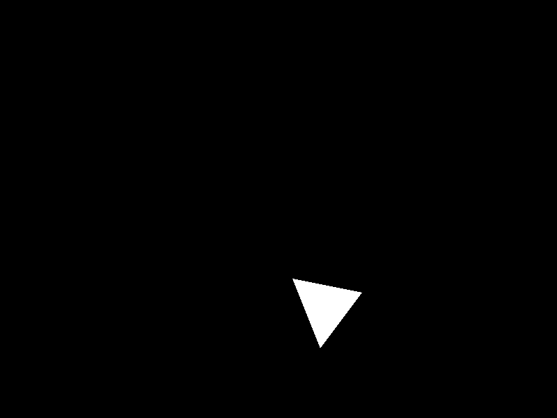
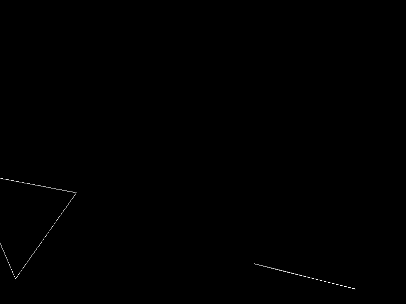
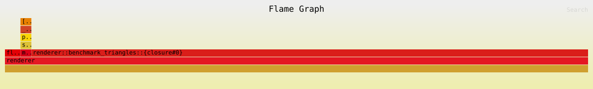

# Rasterizador de triángulos

Este repositorio se encuentra mi versión del rasterizador (antes renderer de .obj's) de triángulos en Rust, en el cual implementé los siguientes tres modos de dibujo:

- **Wireframe:** dibuja únicamente el contorno mediante tres llamadas al algoritmo de línea.
- **FilledBarycentric:** recorre el rectángulo delimitador del triángulo y decide la cobertura de cada centro de píxel con coordenadas baricéntricas.
- **FilledScanline:** encuentra las intersecciones del triángulo con cada fila y rellena el tramo horizontal interior.


## Ejecución

Para abrir la ventana y renderizar el modo seleccionado en `main.rs` (por default scanline `main.rs:325` y renderiza los 8 casos a continuación):

```bash
cargo run --release
```

Para generar automáticamente las doce capturas (cuatro grupos de prueba por tres modos):

```bash
cargo run --release -- --capture-triangles
```

Las imágenes se guardan en `screenshots/triangles/`, con el escenario y el método en el nombre del archivo. Los casos que se realizan son los siguientes:

### Triángulo pequeño y triángulo grande

| Wireframe | Baricéntrico | Scanline |
|---|---|---|
|  |  |  |

### Bordes horizontal y vertical

| Wireframe | Baricéntrico | Scanline |
|---|---|---|
|  |  |  |

### Orden original e inverso de los vértices

| Wireframe | Baricéntrico | Scanline |
|---|---|---|
|  |  |  |

### Triángulo parcialmente fuera del framebuffer y triángulo degenerado

| Wireframe | Baricéntrico | Scanline |
|---|---|---|
|  |  |  |

## Medición de rendimiento

La medición se ejecutó con:

```bash
cargo run --release -- --benchmark-triangles
```

Cada muestra ejecuta los dos algoritmos sobre los mismos ocho triángulos (de los casos anteriores). Se realizaron 100 iteraciones por muestra y siete repeticiones, con los resultados estando en la siguiente tabla:

| Algoritmo | Mediana (100 iteraciones) | Tiempo aproximado por iteración | Fragmentos por iteración |
|---|---:|---:|---:|
| Baricéntrico | 39.931336 ms | 399.313 µs | 107,995 |
| Scanline | 12.373938 ms | 123.739 µs | 107,995 |

En esta ejecución, scanline fue aproximadamente 3.23 veces más rápido que el método baricéntrico. Estos valores dependen del equipo y de la carga del sistema, por lo que el resultado importante es la comparación obtenida bajo las mismas condiciones, no el tiempo absoluto.

## Perfil con flamegraph

El perfil se generó sin abrir la ventana mediante:

```bash
CARGO_PROFILE_RELEASE_DEBUG=true \
RUSTFLAGS="-Cforce-frame-pointers=yes -Clink-arg=-Wl,--no-rosegment" \
cargo flamegraph -- --benchmark-triangles
```

[Abrir el flamegraph interactivo](flamegraph.svg)



## Estructura del Código 

```text
src/
├── algorithms/
│   ├── barycentric.rs
│   ├── scanline.rs
│   ├── triangle.rs
│   └── wireframe.rs
├── framebuffer.rs
├── line.rs
└── main.rs
```

`triangle.rs` contiene los tipos compartidos (`Triangle`, `Fragment`, `TriangleMode` y `TrianglePipeline`). Cada implementación mantiene su propio método de rasterización o renderizado, mientras que `main.rs` contiene los casos de prueba, las mediciones y la generación de capturas.
